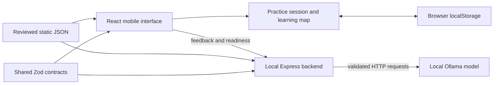

<p align="center">
  
  <br />
  
</p>

<p align="center"><strong>Understand the reasoning behind a wrong answer.</strong><br />Reviewed practice • Local AI feedback • A map of learning evidence</p>

<p align="center"><a href="#getting-started">Get started</a> · <a href="#how-practice-works">Learning flow</a> · <a href="#verification">Verification</a> · <a href="SUBMISSION.md">Submission & disclosures</a></p>

# Bibot — Misconception Mapper

Bibot is a mobile-first student learning app built around a simple question: **why did you choose that answer?** Students work through reviewed multiple-choice questions in Critical Thinking. A wrong answer opens a reasoning field; a locally hosted AI pipeline may identify a possible misconception, ask for clarification, or provide a verified explanation without diagnosis. Reviewed follow-ups and a saved concept map help students see what needs more practice.

This is a 24-hour student build project. The application integrates prepared practice, persistence, local-AI readiness, and the live concept map. Final model acceptance and some evaluation work remain open; implemented UI does not imply that every roadmap or model-quality requirement is complete.

## What you can use

| Capability | Current behavior |
| --- | --- |
| Home and subject selection | Critical Thinking is available; other subjects remain unavailable. |
| Prepared practice library | Six reviewed initial questions, three concepts, and twelve reviewed follow-ups. Uploads are not required. |
| Practice and feedback | Correctness checks, preserved wrong-answer reasoning, pending/error recovery, clarification, diagnosis and verified fallback views. |
| Follow-up practice | A primary and an extra reviewed example per initial question; linked questions test the relevant concept distinction. |
| Learning map | Predefined React Flow graph for induction, deduction and abduction; actual learning evidence determines statuses and recorded confusions. |
| Resume | Browser-local persistence restores the current practice checkpoint and learning map. Start/Continue uses the existing session; completed sessions offer View Completion. There is no reset UI. |
| Readiness | An existing backend signal controls Checking / Ready / Unavailable. A running server alone is insufficient for Ready. |
| Mobile presentation | Nineteen reference-based screen presentations, narrow-phone spacing, safe-area navigation clearance, bundled Fredoka/Nunito fonts and reduced-motion support. |
| Opening and pending states | A brief branding intro before Home; a separate indeterminate bar while feedback is pending. Neither displays invented progress estimates. |

**Disabled or excluded:** uploaded-material practice, pasted-text practice, generated practice content, accounts, databases, real analytics, gamification and document management. Explicit design previews may illustrate additional screens; their contents are not production capabilities or learning evidence.

## How practice works

1. Open **Explore Subjects** or the practice library and select prepared **Critical Thinking** practice.
2. Answer one reviewed multiple-choice question. Correct answers show its verified explanation and allow continuation.
3. After a wrong answer, explain your reasoning. Bibot keeps the question and selected answer visible.
4. The backend returns one validated result:
   - **Diagnosis:** a possible misconception, grounded explanation, reviewed follow-up and uncertainty information where applicable.
   - **Clarification:** a specific prompt for more detail, without a diagnosis.
   - **Fallback:** a verified explanation and reviewed follow-up, **never a diagnosis**.
5. Answer the reviewed follow-up. An extra prepared example is available when appropriate.
6. Open **My Map** to see saved learning evidence. Return Home to continue an unfinished session or view its completion screen.

The first unclear response for a question requests clarification; the second unclear response produces verified fallback. Clarification counts are transient and per question. Backend safeguards also handle invalid model output: validation, one retry, and then a verified fallback with checked references.

### Map statuses

| Status | Color | Meaning |
| --- | --- | --- |
| Not Yet Practiced | Gray | No qualifying learning evidence yet. |
| Needs Review | Red | A wrong answer affected this concept; the consecutive-correct count resets. |
| Improving | Amber | One qualifying correct answer. |
| Understanding Demonstrated | Green | Two consecutive qualifying correct answers for that concept. |

Correct initial answers credit the question's concepts; correct follow-ups credit their concept pair. Recorded confused connections describe wrong-answer history, separately from current concept status. These are evidence-based practice indicators, not a claim of permanent mastery or a model-generated graph.

## Architecture



| Layer | Stack |
| --- | --- |
| Frontend | React, Vite, TypeScript, React Flow and CSS |
| Backend | Local Node.js, TypeScript and Express |
| Inference | Ollama HTTP API; default `qwen2.5:7b` |
| Contracts | Shared Zod schemas and TypeScript types |
| Storage | Versioned browser localStorage; no database or accounts |
| Typography | Self-hosted Fredoka and Nunito |

Runtime requests go from the browser to the configured backend, then to the configured Ollama host. The intended default is local execution. Model output is separate from the frontend-facing `FeedbackResult`; the backend verifies it before returning results. Production feedback uses JSON-schema output, temperature `0.1` and no streaming.

## Getting started

### Prerequisites

- Git, Node.js with npm, and Ollama installed on the host machine.
- Use a Node.js release compatible with the locked toolchain. The installed Vite package declares `^20.19.0 || >=22.12.0`; the project manifests do not declare a separate supported Node range.
- Enough memory and compute capacity to run the selected model. Readiness and latency must be checked on the actual demo machine.
- Internet access for the initial repository, package and model downloads.

Use local model weights for this project's intended runtime. See the [official Ollama setup guide](https://docs.ollama.com/quickstart) for installation and local-model serving.

### 1. Get the repository

```bat
git clone https://github.com/yyytsaB/Bibot.git
cd Bibot
```

If you already have a checkout, inspect `git status` and preserve uncommitted work before updating. Use the checkout that contains `backend/src/index.ts`; an old scaffold-only checkout cannot start the backend. Develop on a separate feature branch.

### 2. Install locked dependencies and build shared contracts

From the repository root:

```bat
npm ci --prefix shared
npm run --prefix shared build
npm ci --prefix backend
npm ci --prefix frontend
```

`npm ci` uses the committed lockfiles. Both applications link the local `shared` package; building it supplies the package's `dist/` entry points. Do not replace locked schemas or edit lockfiles by hand.

### 3. Start Ollama and install the model

Open the Ollama app/service. If you are managing it from a terminal and it is not already running:

```bat
ollama serve
```

In another terminal:

```bat
ollama pull qwen2.5:7b
ollama list
```

Do not start a second Ollama server on the same port. The default local API address is `http://127.0.0.1:11434`. Installing a model does not by itself confirm a successful warm-up.

### 4. Start the backend

Open a terminal at the repository root:

```bat
cd backend
npx --no-install tsx src/index.ts
```

Expected server message:

```text
Backend server running on http://127.0.0.1:3001
```

Keep that terminal open. The server starts its readiness service and attempts warm-up after confirming model availability. Inspect `http://127.0.0.1:3001/api/readiness` for its actual state.

### 5. Start the frontend

Open another terminal at the repository root:

```bat
cd frontend
npm run dev
```

Open the **Local** URL printed by Vite and navigate to `#/home`. Vite normally starts on port 5173 and can choose another port when it is occupied; do not assume the port from a previous session. The development server proxies `/api` to backend port 3001.

The branding intro is approximately 1.1 seconds. It is independent of AI readiness; prepared practice and verified correctness explanations remain usable when the local model is unavailable. AI-dependent feedback may use verified fallback or expose a recoverable error according to the existing pipeline.

### Built output

```bat
npm run --prefix shared build
npm run --prefix backend build
npm run --prefix frontend build
```

Backend compilation outputs the entry point at `backend/dist/src/index.js` because the TypeScript root directory is the backend root. To run compiled backend code:

```bat
cd backend
node dist/src/index.js
```

Keep the repository's `data/` and shared build available. The backend does not serve the frontend's static build. For a local build preview, run `npm run preview` from `frontend/` while the backend is running; the installed Vite implementation inherits the configured `/api` proxy for preview. Vite preview is a local verification server, not a production deployment. An arbitrary static host still needs explicit `/api` routing to Express.

## Runtime configuration

Set environment variables in the backend terminal **before** starting it. No automatic `.env` loader is configured in the inspected entry point.

| Variable | Default | Purpose |
| --- | --- | --- |
| `PORT` | `3001` | Express port; host remains `127.0.0.1`. |
| `OLLAMA_MODEL` | `qwen2.5:7b` | Shared model selection for feedback and readiness. |
| `OLLAMA_BASE_URL` | `http://127.0.0.1:11434` | Ollama base address. |
| `OLLAMA_ENDPOINT` | Base URL + `/api/chat` | Optional chat-endpoint override. |
| `OLLAMA_TIMEOUT_MS` | `15000` | Feedback transport timeout; does not change the separately configured startup warm-up timeout. |

Changing the backend port also requires matching frontend API routing. Model or timeout overrides do not constitute approved final model selection or verified performance. Keep evaluation settings consistent with the authoritative decisions.

### Readiness behavior

- Confirm that Ollama responds and the selected model is installed.
- Attempt warm-up once after availability is confirmed; the current warm-up timeout is 15 seconds.
- Mark Ready only after a non-empty successful warm-up response.
- Subsequently check availability every 15 seconds, with a 2-second availability-check timeout.
- Withdraw readiness after two consecutive availability-check failures.
- A failed warm-up stays unavailable until backend restart; normal polling does not repeat warm-up.

The frontend consumes `GET /api/readiness`; it neither calls Ollama directly nor initiates warm-up.

## API overview

| Endpoint | Purpose |
| --- | --- |
| `GET /api/readiness` | Returns `isReady`, `statusLabel`, `detail`, `model` and `consecutiveFailures`. An HTTP 200 response can still mean unavailable. |
| `POST /api/feedback` | Validates a reviewed question/choice and reasoning, then returns a validated diagnosis, clarification or fallback. |

Example request shape:

```json
{
  "question_id": "q1",
  "student_choice_id": "A",
  "student_reasoning": "The observation led me to this answer.",
  "clarification_attempt_count": 0
}
```

Use actual choice IDs from [the question bank](data/questions.json). `clarification_attempt_count` is optional and must be a non-negative integer. Missing/invalid request fields return 400; unknown question IDs return 404. This example demonstrates the request shape, not a new reviewed evaluation case or promised diagnosis.

## Repository guide

```text
Bibot/
├── frontend/
│   ├── src/components/     Home, practice, readiness, map and design previews
│   ├── src/styles/         Mobile presentation styles
│   ├── src/assets/         Owner-supplied duck art, logo and bundled fonts
│   ├── src/state/          Practice controller, learning evidence and persistence
│   ├── src/api/            Feedback API client
│   └── test/               Frontend tests
├── backend/
│   ├── src/                Express, content loading, feedback pipeline, readiness
│   ├── scripts/            Content/evaluation validators and live evaluation tools
│   └── test/               Offline backend tests
├── shared/src/             Locked Zod contracts and separate development fixtures
├── data/                   Reviewed practice content, metadata and evaluation evidence
├── docs/                   Authoritative specification, decisions and review guidance
├── AGENTS.md               Coding-agent scope and workflow rules
├── roadmap.md              Feature IDs, acceptance criteria and dependencies
├── progress.md             Recorded work, verification and open limitations
└── SUBMISSION.md           Submission checklist and detailed disclosures
```

Primary data files are [concepts](data/concepts.json), [questions](data/questions.json), [follow-ups](data/follow-ups.json) and [content metadata](data/content-metadata.json). Follow-up ID order means **primary first, extra second**. The synthetic explanation evaluation set is separate from runtime practice content.

Normal entry points include `#/home`, `#/subjects`, `#/library`, `#/question` and `#/map`. Routes `#/design-preview/1` through `#/design-preview/19` are an explicitly separate, illustrative design-review surface. A practice route resumes authoritative session state; its URL does not force a fabricated feedback stage.

## Verification

Run these commands from the root. They are documented procedures, not a claim that a new test run occurred while writing this README.

```bat
npm run --prefix shared build
npm run --prefix shared typecheck
npm run --prefix shared lint
npm run --prefix shared test

npm run --prefix backend validate:content
npm run --prefix backend validate:eval
npm run --prefix backend typecheck
npm run --prefix backend build
npm run --prefix backend lint
npm run --prefix backend test

npm run --prefix frontend test
npm run --prefix frontend typecheck:test
npm run --prefix frontend build
npm run --prefix frontend lint
```

Offline automated checks validate contracts, references, pipeline safeguards, practice transitions and persistence. They do not prove live Ollama quality or hardware performance. Live tools such as `smoke:f4`, `test:live-f7` and `eval:runner` in the backend invoke models and are separate evaluation activities; preserve prior evidence and follow the approved evaluation plan before running them.

For a manual integration check, exercise **Home → Practice → reasoning/feedback → reviewed follow-up → Map → Home**, reload during a session, and check a narrow phone viewport plus reduced-motion preference. Clearly record whether feedback was mocked or came from live Ollama. See [progress](progress.md) for historical checks and remaining limitations rather than treating counts as permanently current.

## Troubleshooting

| Symptom | Check / action |
| --- | --- |
| Cannot find `backend/src/index.ts` | You are likely in an older checkout or the wrong folder. Confirm the file exists, preserve local work, and update the correct repository. Do not copy only the entry point without its supporting modules. |
| Cannot resolve `shared` or its build output | Run the shared install/build steps and install committed dependencies in both consumers. |
| `EADDRINUSE` | The port is occupied, possibly by the backend already running. Identify the existing server before starting another. |
| Backend runs but Local AI is unavailable | Inspect `/api/readiness`; confirm Ollama is running and `qwen2.5:7b` is installed. Backend reachability and model readiness are distinct. |
| Model available, startup warm-up failed | Restart the backend to retry once. If it fails again, capture readiness detail immediately after startup; a later poll may replace the original error with the generic restart message. Do not claim readiness or silently change the production timeout. |
| API requests fail in a static preview | Ensure the backend is running and `/api` reaches it. Local Vite development and preview inherit the configured proxy; an arbitrary static host requires explicit routing. |
| Progress appears different after changing the URL/port | localStorage is origin-specific. Use the same scheme, host and port; `localhost` and `127.0.0.1` are separate origins. |
| Git pull asks for a branch | Your feature branch may lack an upstream. Inspect branch/remotes; update explicitly from the intended remote/main after preserving local work. |

### Rehearsal storage clearing

There is no reset UI. To deliberately clear this app's saved rehearsal state, stop practice and run the following in the browser developer console **on the app's origin**:

```js
localStorage.removeItem('mm_state_v1');
location.reload();
```

This discards that origin's saved practice and map evidence. Clarification-attempt counts are not persisted.

## Content, assets and AI disclosure

The approved batch `critical-thinking-c1-reviewed-2026-10-09` was **authored by Codex (AI)**, reviewed by **Karl Andrei on 2026-10-09**, and independently peer-approved by the project owner with confirmation recorded on **2026-10-10**. It is a specific approved exception; it must not be described as human-authored or extended to future content. The fifteen evaluation explanations are reviewed synthetic examples, not real student responses. Conceptual references and item-level review evidence are in [content metadata](data/content-metadata.json) and [the content draft](content-review-draft.md).

The header uses the supplied **BIBOT TITLE.png** and **BIBOTTT.png**, already preserved as repository `wordmark.png` and `app-icon.png`; the asset mapping records the original filenames and SHA-256 hashes. Asset mappings are in [asset-map.json](frontend/src/assets/bibot/asset-map.json). Fredoka and Nunito are bundled with their [source record](frontend/src/assets/fonts/SOURCES.txt) and original SIL Open Font License files.

The owner reports Codex/Gemini coding assistance and image/video generation tools. Exact labels, known contribution boundaries, provenance gaps, internet requirements and pending submission links are disclosed in [SUBMISSION.md](SUBMISSION.md). Artwork licensing/permission and pre-event contribution timing remain to be confirmed; no blanket license for the entire project is asserted here.

## Known limitations

- `qwen2.5:7b` is the starting/default model, not a final evidence-backed selection. The recorded [F5 comparison](data/eval-results/runs/run-2026-10-09T19-58-03-929Z/comparison-summary.md) left selection blocked and human judgments pending.
- Actual readiness can be unavailable after failed warm-up, even when the backend and model are present.
- The latest recorded F7 checkpoint retains the DEV-05 analogy counterexample; verified fallback protects the interface but does not earn a successful diagnosis/clarification evaluation result.
- Demo-machine latency acceptance remains separate from offline tests and browser mock verification.
- Model inference runs on its configured host, not automatically on every student's device. No network-disconnected verification is claimed here.
- Uploads/generated practice and real analytics remain unavailable; preview statistics are explicitly illustrative.
- Progress records are historical. Check current code and evidence when making completion claims.

## Team

Names reproduced as supplied by the owner:

- Bueno, Sebastian Miguel A.
- De Castro, Aldred Laurenze C.
- Talagtag, Karl Andrei C.
- Fanoga, Haidie N.

Individual development roles remain to be confirmed. Demo-video and X/LinkedIn video-post links will follow in [the submission checklist](SUBMISSION.md).

## Working on the project

Read [AGENTS.md](AGENTS.md), [SPEC](docs/SPEC.md), [DECISIONS](docs/DECISIONS.md) and [roadmap](roadmap.md) before proposing changes. The specification/decisions/roadmap govern scope; developer and frontend ownership boundaries remain in force. Plans precede implementation, actual diffs/check results support review, and only approved feature files should be staged. [Reviewer guidance](docs/reviewer.md) applies to the external reviewer rather than the coding agent. Preserve shared contracts, reviewed content and unrelated teammate work.
